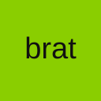
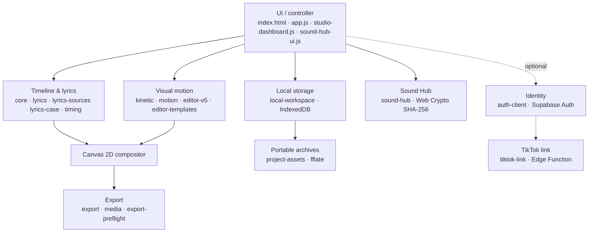

<p align="center">
  
</p>

# Brat Animator

<p>
  <a href="https://github.com/oakvx/bratAnimator/actions/workflows/verify.yml"></a>
  <a href="https://github.com/oakvx/bratAnimator/actions/workflows/pages.yml"></a>
  <a href="https://github.com/oakvx/bratAnimator/commits"></a>
  
  
  <a href="https://github.com/oakvx/bratAnimator/stargazers"></a>
  
  
</p>

Client-side lyric-video compositor and timeline editor. A static, framework-free web app with a deterministic Canvas 2D renderer, browser-native media encoding and a local-first project model. There is no processing backend: audio and video are never uploaded while editing or exporting.

**App:** <https://oakvx.github.io/bratAnimator/> · **License:** all rights reserved (see [LICENSE](./LICENSE))

## Contents

- [Stack](#stack)
- [Architecture](#architecture)
- [Rendering model](#rendering-model)
- [Export pipeline](#export-pipeline)
- [Storage and project format](#storage-and-project-format)
- [Input formats](#input-formats)
- [PWA and offline behavior](#pwa-and-offline-behavior)
- [UI shell](#ui-shell)
- [Optional backend: Supabase and TikTok](#optional-backend-supabase-and-tiktok)
- [Development and testing](#development-and-testing)
- [Repository layout](#repository-layout)
- [Constraints](#constraints)
- [Documentation](#documentation)

## Stack

| Layer | Implementation |
| --- | --- |
| Runtime | Browser-native ECMAScript (ES2022+), HTML5, CSS3 |
| UI | Vanilla DOM; 7.css v0.21.0 (MIT, bundled locally); ARIA tabs |
| Rendering | Canvas 2D; timestamp-driven scene evaluation |
| Media | Web Audio API, HTMLMediaElement, MediaRecorder, WebCodecs (`VideoEncoder`) |
| Export | MP4 via vendored `mp4-muxer`; WebM / local recording; PNG frame export |
| Persistence | IndexedDB (project snapshots, media blobs); `localStorage` (preferences, fallback) |
| Interchange | Versioned JSON snapshots; `.brat.zip` archives via vendored `fflate` |
| Auth (optional) | Supabase Auth: email/password, email OTP, Google OAuth, TikTok Login Kit |
| Edge (optional) | Supabase Edge Function (Deno/TypeScript) for the TikTok OAuth 2.0 flow, server-side token vault |
| Delivery | GitHub Pages; service worker / PWA |
| Tests | Node.js native test runner; Chrome DevTools Protocol browser suites |
| Build | None: no bundler, framework, Node server or required `npm install` |

## Architecture

The browser owns all state and renders locally. Project snapshots reference media blobs stored in IndexedDB.



Design properties:

- **Deterministic evaluation.** Geometry is a pure function of project state, media timestamp and a persisted seed. No accumulated animation state, so preview and export produce the same frames.
- **Local-first.** Workspace JSON and media binaries are browser-resident. An account identity does not imply cloud synchronization.
- **Separated identities.** Guest and authenticated users have logically separate project libraries within one browser profile.
- **Resilient editing.** Debounced autosave, a recoverable temporary project, legacy JSON migrations, explicit error reporting.
- **Sound Hub.** Imported audio is deduplicated by SHA-256 in the shared media database. Favorites, recents and playlists are metadata scoped to the local owner. The editor changes only on explicit insertion.

## Rendering model

Text modes: Brat, Music, Cinematic and **Kinetic Collage**.

Kinetic Collage uses resolution-independent 2D word packing: variable font sizes, adjacency constraints and safe canvas margins. Each stanza gets its own stable, isolated canvas; stanzas are separated by blank LRC lines or `[Verse]` / `[Chorus]` headings. Words appear at their timestamps with no fade, scale or automatic palette swap. The whole stanza is auto-fitted rather than split after a fixed word count. Preview and export share the same compositor and cached geometry.

The *lowercase lyrics* tool (Timing) rewrites lyric text without touching LRC markers or imported word timing. Details: [docs/kinetic-stanzas-lowercase.md](docs/kinetic-stanzas-lowercase.md).

Canvas layout and source timestamps are independent of dashboard effects. Dashboard click sounds are synthesized with Web Audio and are never mixed into exports.

## Export pipeline

| Path | Mechanism | Notes |
| --- | --- | --- |
| Fast MP4 | WebCodecs H.264 video and optional AAC audio, mixed offline via Web Audio, multiplexed with local `mp4-muxer` | Enabled after runtime codec/capability probes (phase 13) |
| Recording fallback | Canvas capture + Web Audio mixer + `MediaRecorder` | Real-time recording; container and codecs depend on the browser |
| Frames | PNG export | |

The fast path is gated by `VideoEncoder.isConfigSupported()` (see `assets/js/export.js`):

- width and height are rounded to even values, minimum 16 px;
- bitrate = `max(4 Mbps, w × h × max(24, fps) × 0.09)`;
- if `VideoEncoder` / `VideoFrame` or the muxer module is missing, the path is reported as unavailable.

Phase 13 introduces `assets/js/export-plan.js` and `assets/js/export-engine.js`. All exports use a shared absolute timeline and support multiple independently trimmed audio sources at engine level. The current interface still exposes one imported audio track; visual multitracks, overlays and embedded video-audio mixing will follow in phases 14–17 of the [single incremental PR](https://github.com/oakvx/bratAnimator/pull/20). Fast MP4 with AAC is available only on browsers supporting the required WebCodecs audio/video encoders; otherwise MediaRecorder provides the compatibility path. See [phase 13 design and limits](docs/phase-13-export-engine.md).

`export-preflight.js` adds a non-blocking readiness checklist built from the real LRC parser and the current media and browser settings. It flags missing or malformed timestamps, absent encoding capability, audio-recording limits and heavy settings (1440p+ at 60 fps). It does not replace the exporter's final codec and CORS validation.

## Professional timeline & editor (phase 17)

The inspector follows **Find → Lyrics → Timeline → Style → Canvas → Export → Project**, with related controls grouped and preserved element IDs. Properties are contextual to selected clip types, optional expert panels are collapsible, and mobile navigation uses the original Brat logo.

The **full-width timeline below the preview** supports pointer-driven clip moves across compatible lanes, edge trimming, snapping to clip edges and playhead, track selection, mouse/touch interaction, keyboard nudging, split-at-playhead, dropping local files, adjustable zoom and fit-to-project. Undo/redo records complete clip gestures as one history step. Timeline clipping and ruler rendering are culled to visible time ranges for longer projects. The underlying graph, media storage and export pipeline stay the same.

[Playwright layout and interaction tests](tests/editor-layout-playwright.mjs) cover desktop and mobile editor panels, clip dragging, history, zoom, the localized English/Italian landing pages and 180-clip virtualization. Browser-specific manual QA remains appropriate before production publishing.

**SEO:** The primary search focus is **Free Brat Video Editor Online** (English) and **Editor Video Brat Gratis Online** (Italian), with substantive localized pages, reciprocal `hreflang`, and structured `WebApplication` data. Free usage does not override the publication/redistribution restrictions in the [terms](terms.html).

## Multitrack model (phase 14)

The `Tracks` editor tab provides a versioned clip/track graph for video, overlays, lyrics and audio. The new `assets/js/multitrack.js` model supports trim, split, move, duplicate, ordering, mute/visibility, locking and stable asset references; `assets/js/multitrack-ui.js` exposes the initial browser controls. The graph is included in IndexedDB saves, project JSON and `.brat.zip` media archives while retaining project format v5 for backward compatibility.

**Phase 15 is now integrated:** local video/image/text clips render in the preview and PNG/MP4/WebM exports, including video-only projects without LRC. The Tracks panel imports multiple local videos and images and controls per-clip X/Y, size, rotation, fit and opacity. Track order controls the visual stack around the legacy lyrics layer. **Phase 16 is now integrated:** decodable soundtracks from imported video clips are mixed with independent music and SFX tracks in the preview and exported MP4/WebM. Embedded video elements stay muted to prevent duplicate sound. Volume, per-track mute, fades and playback speed are controlled in Tracks; codec support depends on the browser. See [phase 16 audio mixer](docs/phase-16-audio-mixer.md). See [video compositor details](docs/phase-15-video-composer.md); the [phase 14 foundation](docs/phase-14-multitrack-core.md) remains available.
## Storage and project format

| Store | Name | Content |
| --- | --- | --- |
| IndexedDB | `bratAnimator.workspace.v1` (object store `projects`) | Project snapshots |
| IndexedDB | `bratAnimator.media.v1` | Media blobs, referenced by asset ID |
| IndexedDB | `bratAnimator.soundhub.v1` | Track and collection metadata (file data stays in the media DB) |

- Project ID and owner ID define the logical workspace boundary.
- Target capacity per browser profile: **20 permanent projects + 1 recoverable temporary project**, enforced by IndexedDB transactions and the browser quota.
- `.brat.zip` contains project metadata and the available local assets. Plain JSON is metadata only and is not a complete multimedia backup.
- Cloud project synchronization is intentionally absent. Browser eviction and cleared site data cannot be prevented, so export `.brat.zip` regularly.

## Input formats

- **Lyrics:** LRC, enhanced LRC, TTML, SRT, WebVTT, Lyricsfile YAML/JSON. Timing can be imported, estimated or adjusted manually.
- **Media:** local audio, images, video backgrounds and custom font files supported by the browser. Remote media are subject to CORS, availability and licensing.

## PWA and offline behavior

`sw.js` precaches the application shell under a versioned cache name (`CACHE_NAME`); older caches are deleted on `activate`.

| Request | Strategy |
| --- | --- |
| Navigations; `supabase-config.js`; `tiktok-config.js` | Network first, cache fallback, `index.html` as offline fallback |
| Other same-origin `GET` | Cache first, network fill |
| Cross-origin or non-`GET` | Not intercepted |

Bump `CACHE_NAME` and the precache list whenever shipped assets change. `tests/deployment-integrity.test.js` checks precache integrity.

## UI shell

The dashboard ships the unmodified upstream `vendor/7css/7.scoped.css` (v0.21.0, MIT). The only dashboard-specific stylesheet is `assets/css/studio-win7.css`, which owns layout and does not repaint native 7.css controls. No runtime CDN is required.

Dialogs use JavaScript-controlled visibility. The dialog role is placed on the overlay, not on the inner `.window`, because 7.css hides `.window[role=dialog]` unless it is activated through `:target`, which is incompatible with event-driven dialogs.

The taskbar Start orb opens a searchable launcher (`win7-start-menu.js`): local labels and aliases only, no network requests and no project data access. Keyboard shortcuts are scoped to the active editor; <kbd>Ctrl/Cmd</kbd>+<kbd>K</kbd> works even while editing text.

## Optional backend: Supabase and TikTok

The editor is fully usable as a guest. Everything below is opt-in.

- **Supabase Auth.** Set the project URL and the public publishable key in `assets/js/supabase-config.js`, then enable providers and redirect allowlists in Supabase. Google OAuth needs provider-side setup; email OTP needs a mail transport. Never put a `service_role` key or an OAuth client secret in browser code.
- **BRATCODE.** Short-lived, origin-bound share links that prefill the import field and require an explicit import action. It exchanges project structure only (no media, no credentials) and is not a sync mechanism. It needs the provided database RPCs/migrations and gateway rate limiting.
- **TikTok Login Kit.** Edge Function with a private identity mapping, single-use OAuth state and a browser-bound login proof. Unlinking removes the server-side tokens even when provider revocation fails. Requires an approved TikTok Developer App, credentials and a deployed function. Music favorites and publishing are out of scope.

Do not claim live external authentication or TikTok linking before provider-side end-to-end tests. Setup: [supabase/README.md](supabase/README.md), [docs/supabase-tiktok-setup.md](docs/supabase-tiktok-setup.md).

## Development and testing

Requirements: a modern browser; Node.js 22.13+ for tests.

Serve the repository root over HTTP (for example `python3 -m http.server`) and open `index.html`. Do not use `file://`: storage, service workers and media APIs need a valid origin.

```sh
node --test                       # unit tests
node --check assets/js/app.js     # syntax checks (repeat per module)

# Chrome DevTools Protocol suites
CHROME_PATH=/usr/bin/google-chrome node tests/studio-dashboard-browser.mjs
CHROME_PATH=/usr/bin/google-chrome node tests/editor-v5-browser.mjs
CHROME_PATH=/usr/bin/google-chrome node tests/export-format-browser.mjs
```

CI requires all nine Chrome suites, the Node unit and syntax checks, TypeScript validation and Deno typing of the Edge Function. Real IndexedDB assertions are part of the browser suites. A green pipeline does not replace manual Safari iOS / Firefox media tests or real provider OAuth tests.

## Repository layout

```text
assets/js/            editor, media, timeline, storage, auth, UI modules
assets/css/           editor CSS; isolated Win7 dashboard layout (studio-win7.css)
vendor/               bundled third-party JS (mp4-muxer, fflate, js-yaml) and 7.css
supabase/             migrations and Edge Function
tests/                Node unit tests and browser automation
docs/                 design notes and rollout plans
index.html            application entry point
sw.js                 service worker
.github/workflows/    CI and static deployment
```

## Constraints

- Retention of browser storage, device memory and codec support bound what a project can do. Large exports can fail on mobile. Phase 13's offline audio mix and in-memory MP4 muxer have particular memory costs.
- Browser-held data is not encrypted by the app and is not an archive.
- Server-side authentication and sharing must enforce authorization, expiry, rate limits and payload limits independently of the UI.
- Importers are responsible for the rights to the media they import or publish.

## Documentation

| Topic | File |
| --- | --- |
| Local foundation | [phase-1-local-foundation.md](docs/phase-1-local-foundation.md) |
| Creator studio | [phase-2-creator-studio.md](docs/phase-2-creator-studio.md) |
| Library, BRATCODE, Aero | [phase-3-library-bratcode-aero.md](docs/phase-3-library-bratcode-aero.md) |
| Sound Hub, classic desktop | [phase-4-sound-hub-classic-desktop.md](docs/phase-4-sound-hub-classic-desktop.md) |
| Windows 7 UI, TikTok link | [phase-5-windows7-tiktok-link.md](docs/phase-5-windows7-tiktok-link.md) |
| Start menu | [phase-6-win7-start-menu.md](docs/phase-6-win7-start-menu.md) |
| Export preflight | [phase-7-export-preflight.md](docs/phase-7-export-preflight.md) |
| Hardening, auth, templates | [phases-8-to-12-rollout.md](docs/phases-8-to-12-rollout.md) |
| Kinetic stanzas, lowercase | [kinetic-stanzas-lowercase.md](docs/kinetic-stanzas-lowercase.md) |
| Export engine v2 (phase 13) | [phase-13-export-engine.md](docs/phase-13-export-engine.md) |
| Multitrack core (phase 14) | [phase-14-multitrack-core.md](docs/phase-14-multitrack-core.md) |
| Video Composer (phase 15) | [phase-15-video-composer.md](docs/phase-15-video-composer.md) |
| Multitrack Audio Mixer (phase 16) | [phase-16-audio-mixer.md](docs/phase-16-audio-mixer.md) |
| Editor layout audit (phase 17) | [phase-17-editor-layout-audit.md](docs/phase-17-editor-layout-audit.md) |
| Professional Timeline (phase 17) | [phase-17-professional-timeline.md](docs/phase-17-professional-timeline.md) |
| Supabase and TikTok | [supabase-tiktok-setup.md](docs/supabase-tiktok-setup.md) |

## License

**All rights reserved.** Public visibility grants no right to reuse, redistribute or modify. See [LICENSE](./LICENSE). Third-party dependencies keep their own licenses.
