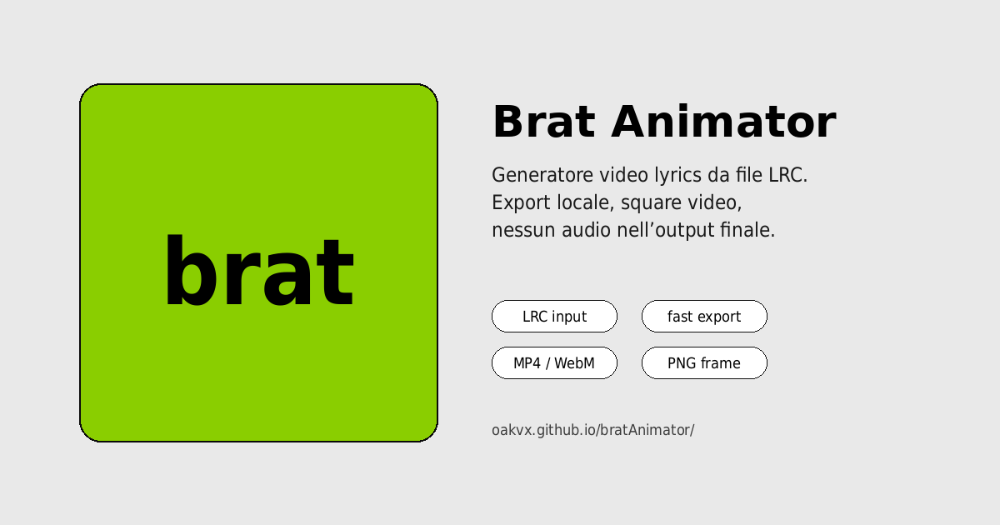

<p align="center">
  
</p>

<h1 align="center">BRAT ANIMATOR</h1>

<p align="center"><strong>Make the words move.</strong></p>

<p align="center">
  A browser-native lyric video studio for expressive typography, precise timing and creative motion.<br/>
  From classic Brat aesthetics to kinetic word compositions — in one focused editor.
</p>

<p align="center">
  <a href="https://oakvx.github.io/bratAnimator/"></a>
  <a href="#quick-start"></a>
</p>

<p align="center">
  
  
  
  
</p>

<p align="center">
  <a href="https://oakvx.github.io/bratAnimator/">
    
  </a>
</p>

<p align="center">
  <a href="#why-brat-animator">Overview</a> ·
  <a href="#features">Features</a> ·
  <a href="#kinetic-collage">Kinetic Collage</a> ·
  <a href="#quick-start">Get started</a> ·
  <a href="#for-developers">Developers</a> ·
  <a href="#permissions--copyright">Permissions</a>
</p>

---

## Why Brat Animator?

**Great lyric videos need more than text on a background.** The rhythm, placement, scale and reveal of each word change how a song feels.

Brat Animator brings those decisions into an accessible, browser-based workspace. Work with synchronized lyrics, shape the typography, refine the motion and render the result — without a dedicated editing suite or a processing server.

**Simple when you want speed. Detailed when you need control.**

- **Preview-first workflow.** See the composition while you build it; refine it in the same workspace.
- **Time-aware typography.** Drive animation with imported word timestamps or adjust estimated timing manually.
- **Creative control.** Combine presets with your own fonts, colors, backgrounds, movement and line-level settings.
- **Projects that travel.** Autosave locally and package project assets for transfer or offline reopening.
- **Browser-native rendering.** The canvas powers both the live preview and exported frames.

> **Made for music-led visuals:** lyric edits, animated typography, short-form videos, experimental titles and graphic compositions.

## Features

| Creative tools | Timing & media | Editor & delivery |
| :--- | :--- | :--- |
| Brat, Music, Cinematic and Kinetic Collage display modes | LRC, Enhanced LRC, TTML, Lyricsfile, SRT and WebVTT import | Simple and advanced editor modes |
| Typeface controls, custom fonts and per-phrase styling | Word-level timing and waveform/timeline tools | Responsive desktop and mobile layout |
| Presets, gradients, color exchange and safe zones | Optional local audio/video and background media | MP4/WebM video and PNG/frame export |
| Stretch, tilt, word entrances and optional beat effects | Audio-informed timing estimates and manual synchronization | Autosave, undo/redo, snapshots and portable projects |
| Bilingual lyric layouts and translations | Timing validation and lyric editing | Keyboard shortcuts and PWA caching |

<sub>Availability of some video encoders, real-time audio recording and media formats depends on browser support. Details below.</sub>

## Kinetic Collage

A different way to animate lyrics: **words accumulate on the canvas, one at a time, until the composition is complete.**

The placement is intentionally varied — not a rigid grid — but the algorithm works within real spatial constraints.

1. **Measure** every word in the composition using the chosen font and size variation.
2. **Find space** with deterministic rectangle packing, avoiding collisions and keeping text inside the canvas.
3. **Auto-fit** the complete composition when necessary instead of discarding words.
4. **Reveal progressively** at the corresponding lyric timestamps. Earlier words stay in place; new words appear **fully opaque**, with no transparency fade.

The result can look spontaneous while remaining reproducible when you seek, reopen or export the project.

**Controls:** LRC lines per composition (1–4), word spacing, size contrast and entrance speed. The blue/cream preset offers a ready-made look; every control can be customized.

<sub>An explicit empty lyric row or a substantial pause starts a new composition. Word timing comes from the imported source where available; missing intervals use the existing timing estimator.</sub>

## Quick start

**1. Open the editor.** Use **[Launch Brat Animator](https://oakvx.github.io/bratAnimator/)**. The application runs directly in a modern browser.

**2. Add lyrics.** Search supported lyric providers or paste/import a timed file. You can also import plain text and use the tap-to-sync workflow.

**3. Check synchronization.** Preview the song, inspect the timeline and waveform, and adjust rows or timestamps where needed.

**4. Build the visual.** Choose a display mode or preset. Adjust typography, color, composition, animation and optional background media.

**5. Preview and export.** Scrub or play the canvas, choose an output format and export. Save a project snapshot or a portable ZIP if you want to revisit the edit later.

### Example: LRC

```lrc
[00:00.00]make the words move
[00:02.40]one phrase at a time
[00:04.90]every frame has a rhythm
```

A basic LRC file supplies line timestamps. Enhanced LRC and supported TTML/Lyricsfile files can preserve finer timing data at the word level.

### Which style should I choose?

| Mode | Best for |
| --- | --- |
| **Brat** | Bold, minimal, central typography and classic Brat-inspired motion |
| **Kinetic Collage** | Dense word compositions with progressive, collision-free placement |
| **Music** | Synced lyric scrolling and word-progress emphasis |
| **Cinematic** | More atmospheric, layered lyric treatments |

## Editing workflow

The editor has six stages: **Lyrics → Timing → Design → Canvas → Export → Project**.

**Simple mode** keeps the main workflow approachable. **Advanced mode** exposes phrase overrides, fonts, translations, text entrance parameters, beat effects and export intervals. All six stages remain available in both modes.

In Brat mode, **Edit text in preview** supports direct manipulation: drag to reposition, resize with corner handles or stretch from side handles. The LRC editor supports row operations, selection, timing adjustments and undo/redo.

Project settings can apply globally or to selected phrases where the feature supports phrase-level overrides. Kinetic Collage scene geometry is configured at project level to keep word layouts consistent.

## Import formats

| Format | Supported information |
| --- | --- |
| **LRC / Enhanced LRC** | Lyric line timestamps and embedded word-level markers |
| **TTML** (`.ttml`, `.xml`) | Line, word and syllable intervals, including some background vocals |
| **Lyricsfile 1.0** (YAML / JSON) | Timed lines and optional word intervals |
| **SRT / WebVTT** | Subtitle cue times; WebVTT inline timestamps when available |
| **TXT** | Plain lyrics for manual or tap-based synchronization |

Brat Animator can search **[LRCLIB](https://lrclib.net/docs)** and **[lrc.red](https://lrc.red/api)**. Their availability, coverage and response times depend on the providers. Imported timing is retained where possible; missing word timing is **estimated, not speech-recognized**.

### Import details

- Native start/end timestamps take precedence over rhythm and audio-based estimates.
- Editing a line's text may invalidate previously attached word anchors for that line.
- Timing tools preserve supported native word markers when shifting or normalizing lines.
- YAML uses safe parsing; oversized or incompatible imports are rejected.
- Source formatting from TTML is not reproduced as an identical visual layout.

## Export & project files

| Output | What to expect |
| --- | --- |
| **MP4** | Fast, video-only encoding when the browser supports the required APIs and codec |
| **WebM / real-time video** | Browser recording path, including optional decoded audio when supported |
| **PNG / frames** | Still image and frame-sequence capture |
| **Project JSON** | Editable settings, lyrics, metadata and local asset references |
| **Portable `.brat.zip`** | A transferable project package containing supported uploaded media and fonts |

Audio and video processing take place in the browser. Adding audio to a rendered video uses real-time recording and can be slower than fast video-only encoding. Codec support, duration and performance vary by device and browser.

**Important:** A project JSON file is not a complete media backup. Local uploads are referenced from browser storage; export a portable project if you need to move them to another device.

## Privacy, offline use & media limitations

- **Local-first:** editing, timeline analysis, rendering and project persistence operate in the browser. Project data is kept in local browser storage and IndexedDB rather than a Brat Animator processing backend.
- **Network features are optional:** lyric lookup, remote media URLs and YouTube previews contact external services.
- **Offline-capable application shell:** after successful caching on a supported secure origin or localhost, bundled projects with available assets can be reopened offline.
- **No YouTube extraction:** YouTube URLs are used only for supported embedded previews and references. No downloading or extraction of YouTube audio/video is implemented.
- **CORS applies:** third-party media may reject access or prevent canvas-safe export; use files and URLs you are authorized to use.

You are responsible for securing the rights to any lyrics, recordings, videos, fonts, logos and other third-party materials you use or publish.

## For developers

Brat Animator is a **static, framework-free JavaScript application**. It has no build step, no required npm installation and no processing backend. The project includes plain HTML/CSS, Canvas rendering, modular timing and export logic, and browser storage.

| Module | Responsibility |
| --- | --- |
| `assets/js/app.js` | Application state, editor orchestration and frame rendering |
| `assets/js/timing.js` | Timecoded lyrics, word timing and estimation |
| `assets/js/motion.js` | Geometry and motion-related calculations |
| `assets/js/kinetic.js` | Deterministic word packing and Kinetic Collage layouts |
| `assets/js/editor-v5.js` | Advanced controls and phrase-level editor integration |
| `assets/js/project-assets.js` | Portable assets and project packaging |
| `assets/js/export.js` | Video export support |
| `sw.js` | Offline asset caching |

### Local development

For **authorized contributors**, serve the repository directory using a small HTTP server:

```bash
python -m http.server 4173
```

Open [http://localhost:4173/](http://localhost:4173/) in a browser. Opening `index.html` as a local file may work for basic editing, but PWA and browser APIs should be tested on localhost or HTTPS.

### Tests

Node.js runs the unit tests without installing application dependencies:

```bash
node --test
```

Additional checks:

```bash
node --check assets/js/app.js
node --check assets/js/kinetic.js
node --check assets/js/editor-v5.js
node --check sw.js
```

Manual release checks live in [tests/manual-checklist.md](tests/manual-checklist.md). The repository also includes browser-specific regression scripts under [tests](tests) for timing, responsive editor behavior, layout and export checks; these require a compatible local Chrome installation and do not replace hands-on QA.

For details of lyric formats, see the [Lyricsfile 1.0 specification](https://github.com/tranxuanthang/lyricsfile/blob/main/SPECIFICATION.md).

## Permissions & copyright

**Brat Animator is publicly viewable, but it is not an open-source licensed project.** The copyright holder reserves all rights.

The official web app may be used subject to the project's terms. **Cloning, publishing, redistributing, modifying, self-hosting, integrating or commercially exploiting the source code requires prior written permission** from the author. See [LICENSE](LICENSE) for the applicable terms.

For licensing or collaboration requests: **oakvx@icloud.com**.

Third-party songs, lyrics, images, trademarks and other media remain the property of their respective rights holders. Brat Animator does not grant licenses to that content.

---

<p align="center">
  <strong>BRAT ANIMATOR</strong><br/>
  Made for lyrics that deserve more than a static screen.<br/>
  <a href="https://oakvx.github.io/bratAnimator/">Open the studio</a> · <a href="#quick-start">Explore the editor</a>
</p>

---

## Languages

- [English](#english)
- [Italiano](#italiano)
- [Español](#español)
- [Français](#français)
- [Deutsch](#deutsch)
- [Português](#português)
- [Русский](#русский)
- [中文](#中文)
- [日本語](#日本語)
- [한국어](#한국어)
- [हिन्दी](#हिन्दी)
- [Ελληνικά](#ελληνικά)

---

## English

Brat Animator is a browser-based motion typography editor for lyric videos. Import timecoded lyrics, fine-tune word timing against audio, experiment with Brat / Music / Cinematic / Kinetic Collage styles, and export video or still frames. Projects can be saved locally or carried between devices in a portable `.brat.zip` package.

Fast MP4 encoding is available for video-only exports in supported browsers. Adding audio uses a real-time browser recording path. YouTube links are preview references only; the app does not download video or extract audio.

## Italiano

**Brat Animator** è un editor di tipografia animata per creare lyric video direttamente nel browser. Puoi cercare e importare testi sincronizzati, perfezionare i timestamp, scegliere preset grafici, personalizzare font e sfondi, controllare l'anteprima ed esportare in MP4, WebM o PNG.

Oltre allo stile Brat classico, offre le modalità Music, Cinematic e **Kinetic Collage**. In quest'ultima, tutte le parole della composizione compaiono progressivamente, con dimensioni e posizioni variabili calcolate per evitare sovrapposizioni. Le parole appaiono completamente opache, senza effetti di trasparenza. I progetti sono salvati localmente e possono essere esportati in un pacchetto portabile `.brat.zip`.

La modalità semplice rende immediati i controlli principali; quella avanzata permette di intervenire sui dettagli di timing, animazione e stile. L'esportazione con audio dipende dalle API supportate dal browser. I link YouTube servono unicamente come riferimento e anteprima: nessun audio o video viene scaricato da YouTube.

## Español

Brat Animator crea lyric videos estilo brat desde letras LRC directamente en el navegador. Puedes buscar en LRCLIB, pegar o importar LRC, ajustar timing con audio/video local, añadir fondos, configurar animaciones de palabras, guardar snapshots y exportar MP4/WebM o PNG.

Fast MP4 es la ruta mas rapida y sigue siendo video-only. Si activas audio cargado, la app usa exportacion realtime y puede unir audio decodificado desde un archivo local o una URL media directa CORS-enabled que tengas permiso para usar. YouTube queda solo como preview/reference y no se descarga ni se extrae.

## Français

Brat Animator crée des lyric videos brat-style depuis des paroles LRC directement dans le navigateur. Vous pouvez chercher sur LRCLIB, coller ou importer du LRC, ajuster le timing avec un audio/video local, ajouter un fond media, regler les animations de mots, sauvegarder des snapshots et exporter en MP4/WebM ou PNG.

L'export Fast MP4 est le chemin le plus rapide et reste video-only. Si l'audio charge est active, l'app effectue un export realtime et peut fusionner l'audio decode depuis un fichier local ou une URL media directe CORS-enabled que vous avez le droit d'utiliser. YouTube reste uniquement preview/reference et n'est ni telecharge ni extrait.

## Deutsch

Brat Animator erstellt brat-style Lyric-Videos aus LRC-Lyrics direkt im Browser. Du kannst LRCLIB durchsuchen, LRC einfuegen oder importieren, Timing mit lokalen Audio/Video-Dateien pruefen, Background-Media hinzufuegen, Wortanimationen konfigurieren, Snapshots speichern und MP4/WebM oder PNG exportieren.

Fast MP4 ist der schnellste Weg und bleibt video-only. Wenn geladenes Audio aktiviert ist, nutzt die App einen Realtime-Export und kann Audio aus einer lokalen Datei oder einer direkten CORS-enabled Media-URL zusammenfuehren, fuer die du Rechte hast. YouTube bleibt nur Preview/Reference und wird nicht heruntergeladen oder extrahiert.

## Português

Brat Animator cria lyric videos brat-style a partir de LRC diretamente no navegador. Voce pode pesquisar no LRCLIB, colar ou importar LRC, ajustar timing com audio/video local, adicionar background media, configurar animacoes de palavras, salvar snapshots e exportar MP4/WebM ou PNG.

Fast MP4 e o caminho mais rapido e continua video-only. Ao ativar audio carregado, o app faz export realtime e pode unir audio decodificado de arquivo local ou URL direta CORS-enabled que voce tem permissao para usar. YouTube fica apenas como preview/reference e nao e baixado nem extraido.

## Русский

Brat Animator создает brat-style lyric videos из LRC lyrics прямо в браузере. Можно искать lyrics через LRCLIB, вставлять или импортировать LRC, уточнять timing локальным audio/video, добавлять background media, настраивать word animation, сохранять snapshots и экспортировать MP4/WebM или PNG.

Fast MP4 остается самым быстрым путем и является video-only. Если включить загруженное audio, приложение делает realtime export и может объединить audio из локального файла или direct CORS-enabled media URL, который вы имеете право использовать. YouTube используется только как preview/reference и не скачивается или извлекается.

## 中文

Brat Animator 可以在浏览器中把 LRC 歌词制作成 brat-style 歌词视频。你可以通过 LRCLIB 搜索，粘贴或导入 LRC，用本地音频/视频校准 timing，添加背景媒体，配置逐词动画，保存项目快照，并导出 MP4/WebM 或 PNG。

Fast MP4 是最快的导出方式，并且仍然是 video-only。启用已加载音频时，应用会使用 realtime export，并可以合并来自本地文件或你有权使用的 direct CORS-enabled media URL 的音频。YouTube 只作为 preview/reference，不会被下载或提取。

## 日本語

Brat Animator は、ブラウザ上で LRC 歌詞から brat-style の lyric video を作成するツールです。LRCLIB 検索、LRC の貼り付け/読み込み、ローカル audio/video による timing 調整、background media、word animation、snapshot、MP4/WebM または PNG export に対応しています。

Fast MP4 は最速の export で、video-only のままです。loaded audio を有効にすると realtime export を使い、使用権のあるローカルファイルまたは direct CORS-enabled media URL から decode した audio を結合できます。YouTube は preview/reference のみで、download や audio extraction は行いません。

## 한국어

Brat Animator는 브라우저에서 LRC 가사로 brat-style lyric video를 만드는 도구입니다. LRCLIB 검색, LRC 붙여넣기/가져오기, 로컬 audio/video timing 조정, background media, word animation, snapshot, MP4/WebM 또는 PNG export를 지원합니다.

Fast MP4는 가장 빠른 경로이며 video-only로 유지됩니다. loaded audio를 켜면 realtime export를 사용하고, 권한이 있는 로컬 파일 또는 direct CORS-enabled media URL에서 decode한 audio를 합칠 수 있습니다. YouTube는 preview/reference 전용이며 download나 extraction을 하지 않습니다.

## हिन्दी

Brat Animator browser में LRC lyrics से brat-style lyric video बनाता है। आप LRCLIB search, LRC paste/import, local audio/video से timing refinement, background media, word animation, snapshots, और MP4/WebM या PNG export इस्तेमाल कर सकते हैं।

Fast MP4 सबसे तेज path है और video-only रहता है। Loaded audio enable करने पर app realtime export करता है और local file या ऐसे direct CORS-enabled media URL से decoded audio merge कर सकता है जिसे इस्तेमाल करने की अनुमति आपके पास है। YouTube केवल preview/reference है; उसे download या extract नहीं किया जाता।

## Ελληνικά

Το Brat Animator δημιουργεί brat-style lyric videos από LRC lyrics μέσα στον browser. Υποστηρίζει LRCLIB search, paste/import LRC, timing με local audio/video, background media, word animation, snapshots και export MP4/WebM ή PNG.

Το Fast MP4 είναι η πιο γρήγορη διαδρομή και παραμένει video-only. Αν ενεργοποιηθεί loaded audio, το app κάνει realtime export και μπορεί να ενώσει audio από local file ή direct CORS-enabled media URL που έχεις δικαίωμα να χρησιμοποιήσεις. Το YouTube είναι μόνο preview/reference και δεν γίνεται download ή extraction.
