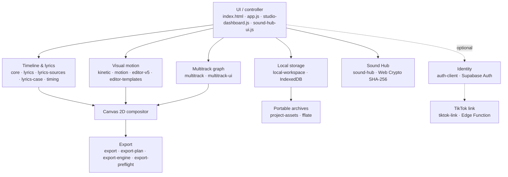

<p align="center">
  
</p>

<div align="center">

# Brat Animator

**a lyric-video compositor that lives entirely in your browser.**

no backend. no uploads. no build step. no framework.
**your machine is the render farm.**

<p>
  <a href="https://github.com/oakvx/bratAnimator/actions/workflows/verify.yml"></a>
  <a href="https://github.com/oakvx/bratAnimator/actions/workflows/pages.yml"></a>
  <a href="https://github.com/oakvx/bratAnimator/commits"></a>
  
  
  <a href="https://github.com/oakvx/bratAnimator/stargazers"></a>
  
  
  
  
  
</p>

**App:** <https://oakvx.github.io/bratAnimator/> · **License:** all rights reserved (see [LICENSE](./LICENSE))

<!-- Screenshot slot — drop a PNG at docs/assets/studio.png and uncomment:
<p align="center">
  
</p>
-->

</div>

> [!IMPORTANT]
> **There is no processing backend.** Audio and video are never uploaded — not while
> editing, not while exporting. Rendering, encoding, mixing and storage all happen
> inside your tab.

```sh
git clone https://github.com/oakvx/bratAnimator && cd bratAnimator
python3 -m http.server        # → http://localhost:8000 — that's the whole setup
```

No `npm install`. No bundler. No Node server. Open the page and you're in the studio.

## Contents

- [The short version](#the-short-version)
- [Stack](#stack)
- [Architecture](#architecture)
- [Rendering model](#rendering-model)
- [Export pipeline](#export-pipeline)
- [The Windows 7 shell](#the-windows-7-shell)
- [Timeline & multitrack](#timeline--multitrack)
- [Storage & project format](#storage--project-format)
- [Input formats](#input-formats)
- [PWA & offline behavior](#pwa--offline-behavior)
- [UI shell field notes](#ui-shell-field-notes)
- [Optional backend](#optional-backend)
- [Naming & SEO](#naming--seo)
- [Development & testing](#development--testing)
- [Repository layout](#repository-layout)
- [Constraints](#constraints)
- [Documentation](#documentation)
- [License](#license)

## The short version

- **Deterministic to the frame.** Geometry is a pure function of project state, media timestamp and a persisted seed. No accumulated animation state — preview and export produce identical frames from the same compositor.
- **Real MP4, zero upload.** WebCodecs H.264 (+ optional AAC) encoded in the browser, mixed offline via Web Audio, muxed with vendored `mp4-muxer`. MediaRecorder as the compatibility path. PNG frames on demand.
- **Multitrack timeline.** Video, overlays, lyrics and audio on a versioned clip/track graph — trim, split, move, snap, per-clip transforms, embedded-audio mixing, gesture-level undo.
- **Local-first.** Snapshots and media blobs live in IndexedDB; portable `.brat.zip` archives via fflate; guest and authenticated libraries stay logically separate.
- **The shell is Windows 7.** Vendored 7.css, a searchable Start menu, a nine-step guided tour on <kbd>F1</kbd> — and a control panel to retheme the whole desktop.
- **Offline PWA.** Precached shell. The app keeps working when the network doesn't.

## Stack

| Layer | Implementation |
| --- | --- |
| Runtime | Browser-native ECMAScript (ES2022+), HTML5, CSS3 |
| UI | Vanilla DOM; 7.css v0.21.0 (MIT, bundled locally); ARIA tabs |
| Rendering | Canvas 2D; timestamp-driven scene evaluation |
| Media | Web Audio API, HTMLMediaElement, MediaRecorder, WebCodecs (`VideoEncoder`) |
| Export | MP4 via vendored `mp4-muxer`; WebM / local recording; PNG frames |
| Persistence | IndexedDB (project snapshots, media blobs); `localStorage` (preferences, fallback) |
| Interchange | Versioned JSON snapshots; `.brat.zip` archives via vendored `fflate` |
| Auth (optional) | Supabase Auth: email/password, email OTP, Google OAuth, TikTok Login Kit |
| Edge (optional) | Supabase Edge Function (Deno/TypeScript) for the TikTok OAuth 2.0 flow, server-side token vault |
| Delivery | GitHub Pages; service worker / PWA |
| Tests | Node.js native test runner; Chrome DevTools Protocol browser suites |
| Build | **None.** No bundler, no framework, no Node server, no required `npm install` |

## Architecture

The browser owns all state and renders locally. Project snapshots reference media blobs stored in IndexedDB.



Design properties:

- **Deterministic evaluation.** Geometry is a pure function of project state, media timestamp and a persisted seed. No accumulated animation state — preview and export produce the same frames.
- **Local-first.** Workspace JSON and media binaries are browser-resident. Having an account does not imply cloud synchronization.
- **Separated identities.** Guest and authenticated users have logically separate project libraries within one browser profile.
- **Resilient editing.** Debounced autosave, a recoverable temporary project, legacy JSON migrations, explicit error reporting.
- **Sound Hub.** Imported audio is deduplicated by SHA-256 in the shared media database. Favorites, recents and playlists are metadata scoped to the local owner. The editor changes only on explicit insertion.

## Rendering model

Four text modes: **Brat**, **Music**, **Cinematic** and **Kinetic Collage**.

Kinetic Collage uses resolution-independent 2D word packing: variable font sizes, adjacency constraints and safe canvas margins. Each stanza gets its own stable, isolated canvas; stanzas are separated by blank LRC lines or `[Verse]` / `[Chorus]` headings. Words appear at their timestamps with no fade, scale or automatic palette swap — the whole stanza is auto-fitted rather than split after a fixed word count. Preview and export share the same compositor and cached geometry.

The *lowercase lyrics* tool (Timing) rewrites lyric text without touching LRC markers or imported word timing. Details: [docs/kinetic-stanzas-lowercase.md](docs/kinetic-stanzas-lowercase.md).

Canvas layout and source timestamps are independent of dashboard effects. Dashboard click sounds are synthesized with Web Audio and are **never mixed into exports**.

## Export pipeline

Three ways out. All client-side.

| Path | Mechanism | Notes |
| --- | --- | --- |
| Fast MP4 | WebCodecs H.264 video + optional AAC audio, mixed offline via Web Audio, multiplexed with local `mp4-muxer` | Enabled only after runtime codec/capability probes (phase 13) |
| Recording fallback | Canvas capture + Web Audio mixer + `MediaRecorder` | Real-time; container and codecs depend on the browser |
| Frames | PNG export | |

The fast path is gated by `VideoEncoder.isConfigSupported()` (see `assets/js/export.js`):

- width and height are rounded to even values, minimum 16 px;
- bitrate = `max(4 Mbps, w × h × max(24, fps) × 0.09)`;
- if `VideoEncoder` / `VideoFrame` or the muxer module is missing, the path is reported as unavailable — never half-works.

Phase 13 introduced `assets/js/export-plan.js` and `assets/js/export-engine.js`: all exports run on a shared absolute timeline, with engine-level support for multiple independently trimmed audio sources. Multitrack audio and video composition landed through phases 14–16 (see [Timeline & multitrack](#timeline--multitrack)) — all shipped as [one incremental PR](https://github.com/oakvx/bratAnimator/pull/20). Details: [phase 13 design and limits](docs/phase-13-export-engine.md).

> [!NOTE]
> Fast MP4 with AAC requires a browser that ships the needed WebCodecs audio/video
> encoders — probed at runtime, never assumed. Everywhere else, MediaRecorder is the
> compatibility path. Large exports can fail on mobile; preflight flags heavy
> settings (1440p+ at 60 fps).

`export-preflight.js` adds a non-blocking readiness checklist built from the real LRC parser and the current media and browser settings. It flags missing or malformed timestamps, absent encoding capability, audio-recording limits and heavy settings. It does **not** replace the exporter's final codec and CORS validation.

## The Windows 7 shell

Yes, the UI is a Windows 7 desktop. It's not a joke, and it's not a skin: it's the vendored **7.css** framework driving real windows, menus and controls.

**Aero workspace.** The dashboard is an Explorer-style window. Sound Hub is a two-column file manager: collection navigation, drop-to-import audio, keyboard/double-click preview, and a compact transport that appears only after a track is selected. The promotional home banner is gone; **Brat Animator** stays the visible product name.

**Personalization.** In **Start → Pannello di controllo → Personalizzazione di Windows 7** you can add original boot frames, wallpaper, Start button, icons and sounds. The browser saves the files locally and serves them offline. Guides: [theme files](docs/windows7-desktop-edition.md#file-del-tema) · [WAV table](assets/sounds/windows7/README.md).

**Guided onboarding.** A **nine-step interactive tutorial** launches from **? Guida** (dashboard/home), the editor's **Help** button, or <kbd>F1</kbd>. It navigates the real editor, introduces audio and project backup, and offers optional undoable actions (example lyrics, a sample text layer). Native Aero window controls and progress navigation throughout.

## Timeline & multitrack

**Inspector.** Ordered **Find → Lyrics → Timeline → Style → Canvas → Export → Project**, with related controls grouped and original element IDs preserved. Properties are contextual to the selected clip type, expert panels are collapsible, and mobile navigation uses the original Brat logo.

**The timeline.** Full-width, below the preview. Pointer-driven clip moves across compatible lanes, edge trimming, snapping to clip edges and playhead, track selection, mouse/touch, keyboard nudging, split-at-playhead, dropping local files, adjustable zoom and fit-to-project. Undo/redo records a complete clip gesture as **one** history step. Clipping and ruler rendering are culled to visible time ranges — long projects stay smooth.

**Tracks (phase 14).** A versioned clip/track graph (`assets/js/multitrack.js` + `multitrack-ui.js`): trim, split, move, duplicate, ordering, mute/visibility, locking, stable asset references. The graph is included in IndexedDB saves, project JSON and `.brat.zip` archives, with project format **v5** retained for backward compatibility. Foundation: [phase 14 docs](docs/phase-14-multitrack-core.md).

**Video composer (phase 15).** Local video/image/text clips render in the preview and in PNG/MP4/WebM exports — including video-only projects with no LRC at all. The Tracks panel imports multiple local videos and images and controls per-clip X/Y, size, rotation, fit and opacity. Track order defines the visual stack around the legacy lyrics layer. Details: [phase 15 docs](docs/phase-15-video-composer.md).

**Audio mixer (phase 16).** Decodable soundtracks from imported video clips are mixed with independent music and SFX tracks in the preview and in exported MP4/WebM. Embedded video elements stay muted to prevent duplicate sound. Volume, per-track mute, fades and playback speed live in Tracks. Codec support depends on the browser. Details: [phase 16 docs](docs/phase-16-audio-mixer.md).

[Playwright layout and interaction tests](tests/editor-layout-playwright.mjs) cover desktop and mobile editor panels, clip dragging, history, zoom, the localized English/Italian landing pages and 180-clip virtualization. Browser-specific manual QA remains appropriate before production publishing.

## Storage & project format

| Store | Name | Content |
| --- | --- | --- |
| IndexedDB | `bratAnimator.workspace.v1` (object store `projects`) | Project snapshots |
| IndexedDB | `bratAnimator.media.v1` | Media blobs, referenced by asset ID |
| IndexedDB | `bratAnimator.soundhub.v1` | Track and collection metadata (file data stays in the media DB) |

- Project ID and owner ID define the logical workspace boundary.
- Target capacity per browser profile: **20 permanent projects + 1 recoverable temporary project**, enforced by IndexedDB transactions and the browser quota.
- `.brat.zip` contains project metadata plus the available local assets. Plain JSON is metadata only — it is **not** a complete multimedia backup.
- Cloud synchronization is intentionally absent.

> [!WARNING]
> **Browser storage is not a backup.** IndexedDB data can be evicted, and cleared
> site data cannot be prevented. Export a `.brat.zip` regularly. Browser-held data
> is not encrypted by the app.

## Input formats

- **Lyrics:** LRC, enhanced LRC, TTML, SRT, WebVTT, Lyricsfile YAML/JSON. Timing can be imported, estimated or adjusted manually.
- **Media:** local audio, images, video backgrounds and custom font files supported by the browser. Remote media are subject to CORS, availability and licensing.

## PWA & offline behavior

`sw.js` precaches the application shell under a versioned cache name (`CACHE_NAME`); older caches are deleted on `activate`.

| Request | Strategy |
| --- | --- |
| Navigations; `supabase-config.js`; `tiktok-config.js` | Network first, cache fallback, `index.html` as offline fallback |
| Other same-origin `GET` | Cache first, network fill |
| Cross-origin or non-`GET` | Not intercepted |

Bump `CACHE_NAME` and the precache list whenever shipped assets change. [`tests/deployment-integrity.test.js`](tests/deployment-integrity.test.js) checks precache integrity.

## UI shell field notes

- 7.css ships **unmodified** (`vendor/7css/7.scoped.css`, v0.21.0, MIT). The only dashboard-specific stylesheet is `assets/css/studio-win7.css`, which owns layout and does not repaint native 7.css controls. No runtime CDN anywhere.
- **Dialog quirk, documented for posterity:** the `dialog` role sits on the overlay, not the inner `.window` — 7.css hides `.window[role=dialog]` unless it's activated via `:target`, which is incompatible with event-driven dialogs.
- The taskbar Start orb opens a searchable launcher (`win7-start-menu.js`): local labels and aliases only. No network requests. No project data access.
- Keyboard shortcuts are scoped to the active editor; <kbd>Ctrl/Cmd</kbd>+<kbd>K</kbd> works even while editing text.

## Optional backend

The editor is fully usable as a guest. Everything below is opt-in.

- **Supabase Auth.** Set the project URL and the *public* publishable key in `assets/js/supabase-config.js`, then enable providers and redirect allowlists in Supabase. Google OAuth needs provider-side setup; email OTP needs a mail transport.
- **BRATCODE.** Short-lived, origin-bound share links that prefill the import field and require an explicit import action. They exchange project structure only — no media, no credentials — and are not a sync mechanism. Requires the provided database RPCs/migrations and gateway rate limiting.
- **TikTok Login Kit.** An Edge Function with a private identity mapping, single-use OAuth state and a browser-bound login proof. Unlinking removes the server-side tokens even when provider revocation fails. Requires an approved TikTok Developer App, credentials and a deployed function. Music favorites and publishing are out of scope.

> [!CAUTION]
> Never put a `service_role` key or an OAuth client secret in browser code. And
> don't claim live external auth or TikTok linking anywhere until provider-side
> end-to-end tests actually pass.

Setup: [supabase/README.md](supabase/README.md) · [docs/supabase-tiktok-setup.md](docs/supabase-tiktok-setup.md)

## Naming & SEO

Primary search focus: **Free Brat Video Editor Online** (English) and **Editor Video Brat Gratis Online** (Italian) — with substantive localized pages, reciprocal `hreflang`, and structured `WebApplication` data. The "Free" marketing lives in metadata only: it is intentionally absent from the visible app and localized guide headings. Free usage does not override the publication/redistribution restrictions in the [terms](terms.html).

## Development & testing

Requirements: a modern browser; Node.js 22.13+ for tests.

Serve the repository root over HTTP and open `index.html`. **Never** use `file://`: storage, service workers and media APIs need a valid origin.

```sh
node --test                       # unit tests
node --check assets/js/app.js     # syntax checks (repeat per module)

# Chrome DevTools Protocol suites
CHROME_PATH=/usr/bin/google-chrome node tests/studio-dashboard-browser.mjs
CHROME_PATH=/usr/bin/google-chrome node tests/editor-v5-browser.mjs
CHROME_PATH=/usr/bin/google-chrome node tests/export-format-browser.mjs
```

CI requires all nine Chrome suites, the Node unit and syntax checks, TypeScript validation and Deno typing of the Edge Function. Real IndexedDB assertions live in the browser suites. A green pipeline does not replace manual Safari iOS / Firefox media tests or real provider OAuth tests.

## Repository layout

```text
assets/js/            editor, media, timeline, storage, auth, UI modules
assets/css/           editor CSS; isolated Win7 dashboard layout (studio-win7.css)
vendor/               bundled third-party JS (mp4-muxer, fflate, js-yaml) and 7.css
supabase/             migrations and Edge Function
tests/                Node unit tests and browser automation
docs/                 design notes and rollout plans
index.html            application entry point
sw.js                 service worker
.github/workflows/    CI and static deployment
```

## Constraints

- Browser storage retention, device memory and codec support bound what a project can do. Large exports can fail on mobile. Phase 13's offline audio mix and in-memory MP4 muxer have particular memory costs.
- Browser-held data is not encrypted by the app and is not an archive.
- Server-side authentication and sharing must enforce authorization, expiry, rate limits and payload limits independently of the UI.
- Importers are responsible for the rights to the media they import or publish.

## Documentation

| Topic | File |
| --- | --- |
| Local foundation | [phase-1-local-foundation.md](docs/phase-1-local-foundation.md) |
| Creator studio | [phase-2-creator-studio.md](docs/phase-2-creator-studio.md) |
| Library, BRATCODE, Aero | [phase-3-library-bratcode-aero.md](docs/phase-3-library-bratcode-aero.md) |
| Sound Hub, classic desktop | [phase-4-sound-hub-classic-desktop.md](docs/phase-4-sound-hub-classic-desktop.md) |
| Windows 7 UI, TikTok link | [phase-5-windows7-tiktok-link.md](docs/phase-5-windows7-tiktok-link.md) |
| Start menu | [phase-6-win7-start-menu.md](docs/phase-6-win7-start-menu.md) |
| Export preflight | [phase-7-export-preflight.md](docs/phase-7-export-preflight.md) |
| Hardening, auth, templates | [phases-8-to-12-rollout.md](docs/phases-8-to-12-rollout.md) |
| Kinetic stanzas, lowercase | [kinetic-stanzas-lowercase.md](docs/kinetic-stanzas-lowercase.md) |
| Export engine v2 (phase 13) | [phase-13-export-engine.md](docs/phase-13-export-engine.md) |
| Multitrack core (phase 14) | [phase-14-multitrack-core.md](docs/phase-14-multitrack-core.md) |
| Video Composer (phase 15) | [docs/phase-15-video-composer.md](docs/phase-15-video-composer.md) |
| Multitrack Audio Mixer (phase 16) | [docs/phase-16-audio-mixer.md](docs/phase-16-audio-mixer.md) |
| Editor layout audit (phase 17) | [phase-17-editor-layout-audit.md](docs/phase-17-editor-layout-audit.md) |
| Professional Timeline (phase 17) | [phase-17-professional-timeline.md](docs/phase-17-professional-timeline.md) |
| Supabase and TikTok | [supabase-tiktok-setup.md](docs/supabase-tiktok-setup.md) |

## License

**All rights reserved.** Public visibility grants no right to reuse, redistribute or modify. See [LICENSE](./LICENSE). Third-party dependencies keep their own licenses.

---

<div align="center">

**the render farm is a browser tab.**

</div>
